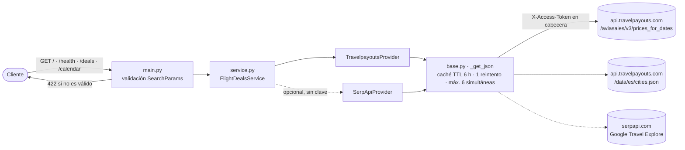
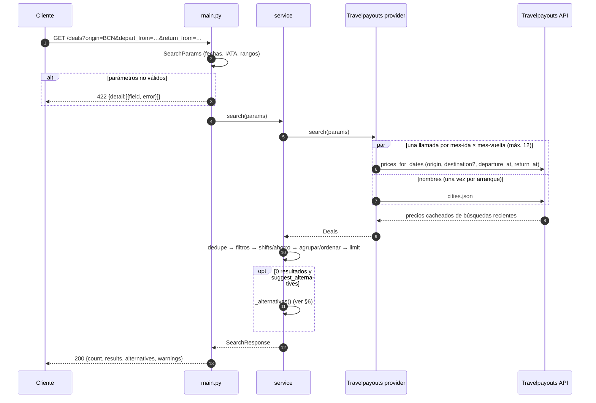
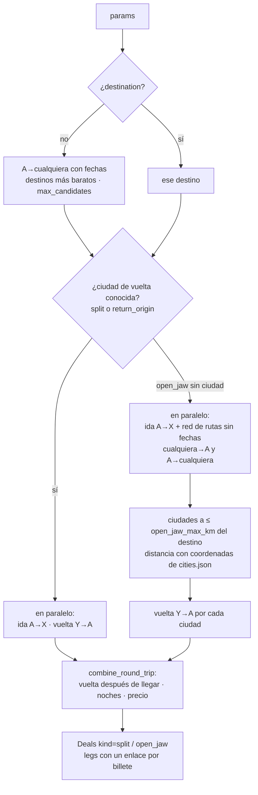
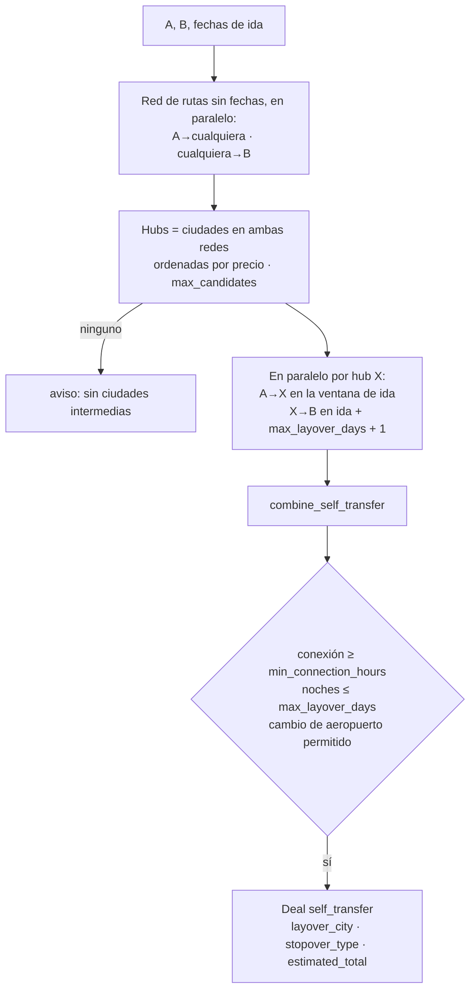
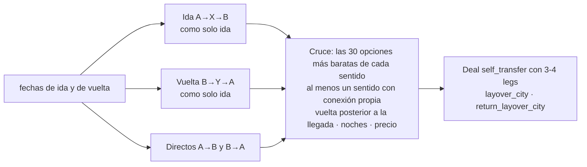
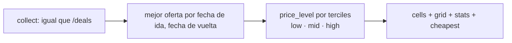
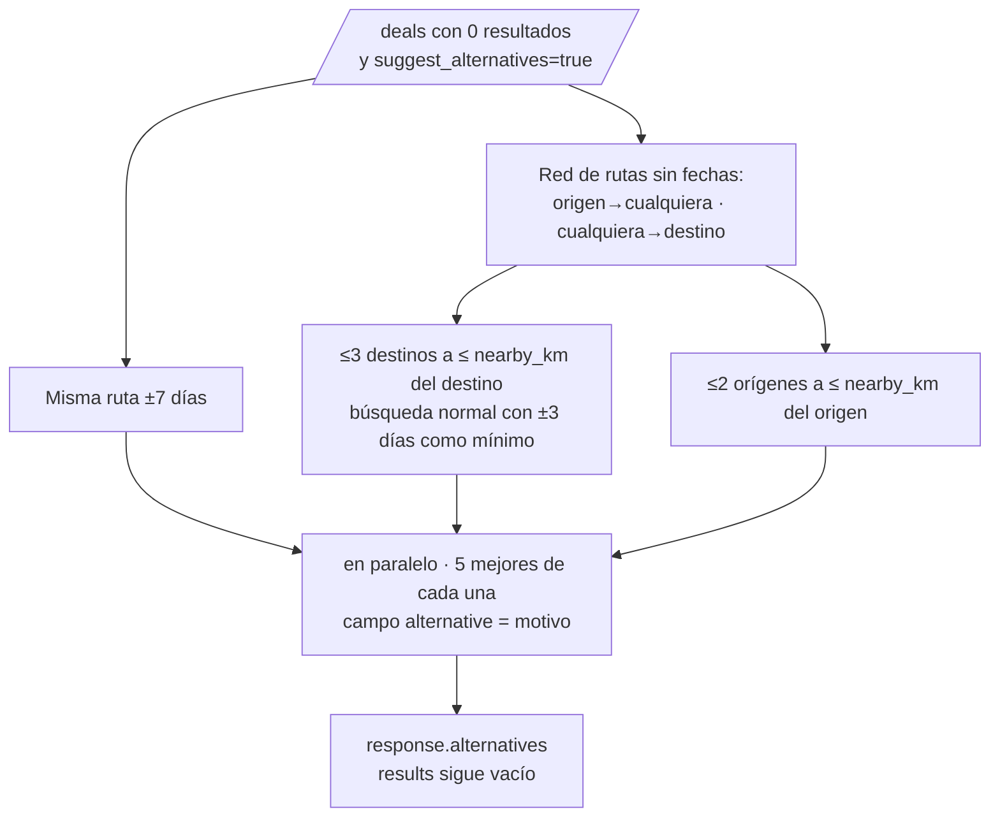
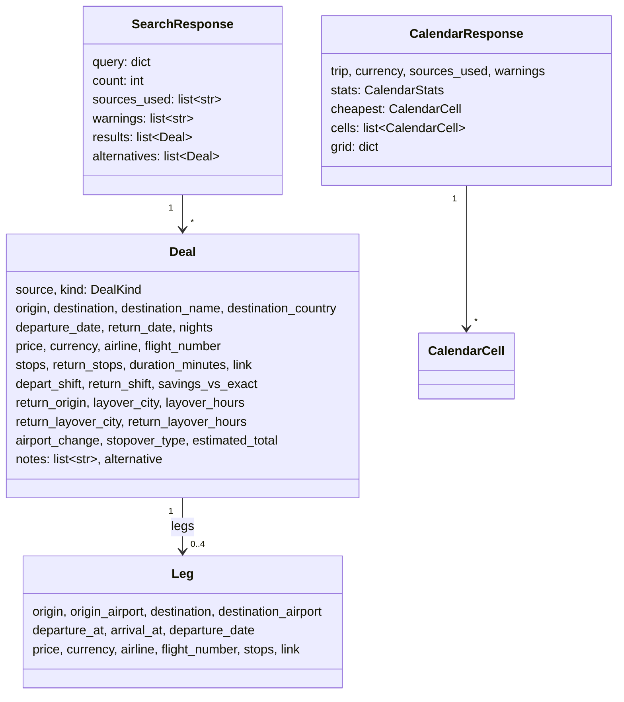

# Arquitectura y contrato de la API

Diagramas de las llamadas de **Flight Deals API v1.2.0** (Mermaid: GitHub los dibuja solos) y resumen
del contrato. El contrato completo y exacto está en [`openapi.json`](openapi.json). Para regenerarlo:
`python scripts/export_openapi.py`. Un test comprueba que no se desincroniza del código.

## 1. Vista general

| Pieza | Qué hace |
|---|---|
| `main.py` | Lee los parámetros, los valida y traduce errores a HTTP (422 / 502 / 503) |
| `service.py` | Decide qué consultas lanzar según el modo, combina billetes, filtra, deduplica, anota y ordena |
| `providers/travelpayouts.py` | Construye cada consulta, convierte la respuesta en `Deal` / `Leg`, nombres, coordenadas y distancias |
| `providers/base.py` | GET con caché (el token no forma parte de la clave), reintento ante 429/5xx/red, clasificación de errores |

## 2. `GET /deals`: búsqueda normal

Errores de proveedor: una consulta rechazada (HTTP 400, p. ej. un IATA desconocido) devuelve `200`
con aviso. Si fallan todas las fuentes, `502`. Si no hay ninguna configurada, `503`.

## 3. Billetes sueltos y open-jaw (`split_tickets`, `open_jaw`, `return_origin`)

Se lanzan **en paralelo** a la búsqueda normal, que sirve de referencia para `savings_vs_exact`.

## 4. Modo avanzado (`mode=advanced`): conexión por cuenta propia

### Solo ida A→X→B

### Ida y vuelta

## 5. `GET /calendar`

Usa el mismo `collect()` que `/deals`, con todos sus modos. Luego se queda con el más barato por
(fecha de ida, fecha de vuelta), calcula `stats` y el tercio de precio (`price_level`), y monta `grid`.

## 6. Alternativas cuando no hay resultados

## 7. Llamadas externas por modo

Todas pasan por la caché (6 h), así que repetir una búsqueda parecida no vuelve a llamar.

| Modo | Llamadas a `prices_for_dates` |
|---|---|
| Normal | 1 por mes-ida × mes-vuelta (máx. 12) |
| `split_tickets` con destino | +1-2 por mes |
| `split_tickets` a cualquier destino | +1 de descubrimiento + 2 por candidato |
| `open_jaw` sin ciudad | +2 de red de rutas + 1 por ciudad de vuelta |
| `mode=advanced` solo ida | +2 de red de rutas + 2 por hub (máx. 15 hubs) |
| `mode=advanced` ida y vuelta | el doble que solo ida, +2 de directos |
| Alternativas (solo con 0 resultados) | +2 de red de rutas + 1 búsqueda normal por alternativa (máx. 6) |

`cities.json` se pide una sola vez por arranque.

## 8. Contrato (resumen)

### Endpoints

| Método y ruta | Respuesta 200 | Errores |
|---|---|---|
| `GET /` | Presentación en inglés: qué hace, fuente de datos, endpoints, ejemplos y fuentes activas | — |
| `GET /health` | `HealthResponse {status, providers[]}` | — |
| `GET /deals` | `SearchResponse` | 422, 502, 503 |
| `GET /calendar` | `CalendarResponse` (necesita fechas de ida) | 422, 502, 503 |

**`/deals` frente a `/calendar`:** aceptan los mismos parámetros y hacen la misma búsqueda.
`/deals` devuelve una lista de ofertas ordenada (`sort`, `limit`, `group_by_destination`) y
`alternatives` si no hay resultados. `/calendar` devuelve una celda por fecha (o par de fechas) con
el precio más barato, `price_level`, `stats` y `grid`, y necesita fechas de ida.

Las descripciones completas, las llamadas de ejemplo y las respuestas de ejemplo están en el
contrato: `/docs` y `docs/openapi.json` (textos en `app/openapi_docs.py`).

### Parámetros de `/deals` y `/calendar` (query string)

| Grupo | Parámetros |
|---|---|
| Ruta | `origin`* · `destination` · `sources` · `currency` |
| Fechas | `depart_from` · `depart_to` · `return_from` · `return_to` · `trip_type` (`auto`/`one_way`/`round_trip`) |
| Filtros | `min_price` · `max_price` · `min_nights` · `max_nights` · `direct_only` |
| Resultado | `sort` (`price`/`price_per_night`/`nights_desc`/`closest`/`score`/`duration`) · `group_by_destination` · `limit` |
| Fechas flexibles | `flex_days` · `depart_flex` · `return_flex` (0-7) · `max_shift_total` · `shift_penalty` |
| Billetes sueltos | `split_tickets` · `open_jaw` · `return_origin` · `open_jaw_max_km` · `max_candidates` |
| Modo avanzado | `mode` (`standard`/`advanced`) · `max_layover_days` · `min_connection_hours` · `allow_airport_change` · `stopover_cost_per_night` |
| Alternativas | `suggest_alternatives` · `nearby_km` |

\* obligatorio. Las reglas de validación (fechas pasadas, rangos invertidos, combinaciones
incompatibles…) están en `SearchParams._check` y devuelven `422`.

### Respuestas

`DealKind`: `one_way` · `round_trip` · `split` · `open_jaw` · `self_transfer`.
Los campos vacíos se omiten de la respuesta.

| Código | Cuerpo |
|---|---|
| `422` | `{"detail": [{"field": "depart_from", "error": "…"}]}` |
| `502` | `{"detail": ["travelpayouts: …"]}` (avisos de cada fuente) |
| `503` | `{"detail": "No hay proveedores disponibles…"}` |
